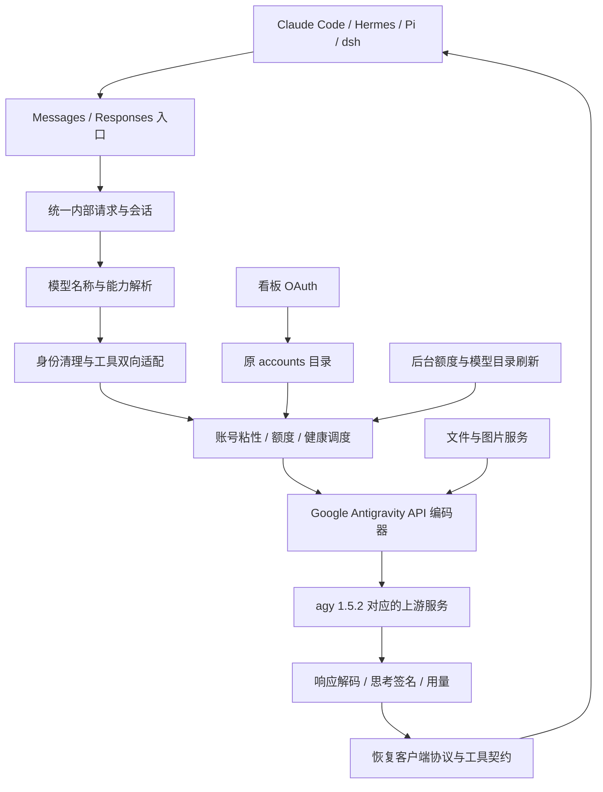

# Antigravity Gateway 产品重构说明

版本：1.3\
产品版本：Antigravity Gateway 2.0.0（文档版本独立计数）\
整理日期：2026-11-07，Asia/Kuala_Lumpur\
重构前基线：本机 Antigravity Gateway 1.7.5 冻结工作区、已安装客户端及 agy 1.5.2 探测材料；下文“当前基线”均指该冻结基线，不指实施中的最新源码。\
文档性质：已确认的产品要求、实现约定、技术探测任务及验收标准。本文不代表重构已经完成或已经发布。

阅读顺序：先看[目标与前后差异](#2-已确认的约定与前后差异)，再看[工具转换](#7-工具标准化与兼容转换)、[身份清理](#8-身份清理)、[账号池保留规则](#10-账号池粘性与额度保留)和[安装与数据兼容](#13-安装数据兼容与旧账号处理)；实施与交付以[验收矩阵](#15-验收矩阵)为准。

| 章节 | 内容 |
| --- | --- |
| [1—3](#1-产品目标) | 产品目标、15 条确定约定、修改前后差异与架构 |
| [4—5](#4-对外接口与客户端接入) | 两套入口、四客户端接入、上游探测范围与字段标准 |
| [6—8](#6-模型目录与思考档位) | 模型档位、工具双向转换、框架身份与用户内容边界 |
| [9—12](#9-会话流式和异常语义) | 会话恢复、流式异常、账号调度、额度、多模态及看板 |
| [13—16](#13-安装数据兼容与旧账号处理) | 原位升级、旧账号隔离、交付物、33 项验收与证据索引 |

## 1. 产品目标

将 Antigravity Gateway 重构为一个通过 **Google Antigravity API 协议**访问多账号模型资源的本地网关：

- 对外提供 Anthropic Messages API、OpenAI Responses API 两种推理协议。
- 对内只保留 agy 1.5.2 对应的 Google Antigravity API 协议及其必要支撑服务。
- 首批完整适配本机 Claude Code CLI、Hermes、Pi、dsh。
- 标准化请求、工具声明、工具调用、工具结果、媒体输入及模型思考配置。
- 工具仍由发起请求的 agent 执行；网关负责协议转换和模型服务。
- 新增账号只通过看板 OAuth 授权；已有 agy 账号继续使用。
- 保留现有账号粘性、额度判断、账号健康管理、视频理解、图片生成及数据持久化。
- 安装命令、安装位置规则、默认端口、配置目录和已有 agy 账号保存位置保持不变。

本文统一使用“Google Antigravity API 协议”。该名称表示基于实际请求探测和逆向分析整理的协议，不表示 Google 已公开发布同名规范。旧源码中的内部标识、历史数据字段及真实主机名可以作为技术字面值保留，不能据此混淆对外协议与上游协议。

## 2. 已确认的约定与前后差异

### 2.1 不可偏离的产品约定

| 编号 | 约定 |
| --- | --- |
| R01 | 上游只保留 Google Antigravity API；移除 Robin、Gemini 网页通道、agy 子进程推理兜底。 |
| R02 | 登录授权、令牌刷新、项目发现、模型目录、额度、生成、流式、压缩、媒体处理属于同一上游的必要支撑，不因 R01 被删除。 |
| R03 | 对外推理入口为 Messages 和 Responses，两者使用同一网关服务及现有端口。 |
| R04 | 新增账号唯一入口是看板 OAuth；不提供凭据文件导入、本机 agy 登录态导入或终端添加账号。 |
| R05 | 通过实际 agy 1.5.2 请求建立标准；不得仅更新 UA 字符串或套用旧工具模板就宣称完成适配。 |
| R06 | 工具尽量标准化名称、参数及声明；仅将可逆等价的能力映射为官方工具，其他真实能力走兼容声明。 |
| R07 | 不虚构客户端不存在的工具或参数；网关不代替 agent 执行其工具。 |
| R08 | 清理可可靠识别的客户端框架身份；保留用户 SOUL、AGENTS.md、项目规则、用户任务及真实执行约束。 |
| R09 | 带档位的模型名称唯一决定上游思考配置；客户端冲突思考参数直接忽略，不报错、不警告、不覆盖。 |
| R10 | 保留视频理解、图片生成、图片编辑和必要媒体服务；模型能力与客户端输入格式分别建模。 |
| R11 | 保留现有账号粘性、权重调度、额度判断、保护阈值、恢复条件及相应持久化。 |
| R12 | 保持原安装命令、安装位置规则、配置目录、账号保存位置及端口；沿用现有 agy 数据。 |
| R13 | 旧 Robin／Windows Gemini 凭据原地保留但不加载，不参与路由，不转换为 agy 账号。 |
| R14 | 探测记录必须区分“真实抓包验证”“源码证据”“待验证”，不得将计划写成验收结果。 |
| R15 | 独立 Messages typed `web_search` 仅转发一次官方专用搜索辅助请求，返回真实 Google 来源链接及上游原摘要，准确显示实际辅助模型。网关不抓网页、不规划、不另做总结或工具执行；不能忠实转换的限制明确拒绝。 |

R09 的优先级高于此前“思考参数冲突时报错”的讨论方案。重构说明、代码、测试和客户端接入说明都必须采用最终约定。

### 2.2 修改前后对比

| 方面 | 当前基线 | 重构目标 |
| --- | --- | --- |
| 上游运行路径 | agy 对应 API、Robin、Windows Gemini，另有 agy 子进程相关路径 | 单一 Google Antigravity API 上游 |
| 推理入口 | Messages、Responses、Chat Completions | Messages、Responses |
| 新增账号 | 看板 OAuth、终端添加及本机登录态自动导入等路径并存 | 仅看板 OAuth |
| 账号加载 | agy 目录与其他通道目录均有运行时加载模块 | 只加载原 agy 账号目录 |
| 请求标准 | 已有 1.5.2 样本适配，部分旧实现仍并存 | 有版本、有证据、有覆盖矩阵的统一编码器 |
| 工具处理 | 当前主要直连路径保留客户端契约；另有旧工具映射 | 经验证的等价映射与扩展工具兼容统一管理 |
| 独立服务器搜索 | 客户端可发出二级 typed 搜索，但旧入口没有完整支持 | 仅独立 Messages 搜索走一次目录声明的官方 helper；真实链接与上游摘要交回 agent，普通对话模型及档位不变 |
| 参数结构 | 部分复杂 Schema 存在有损简化 | 原始契约保留，可表达部分准确转换，不可表达部分采用验证过的兼容方式 |
| 身份处理 | 少量精确模板清理，部分历史客户端专用逻辑 | 按可靠来源与语义范围清理，保护用户内容 |
| 思考配置 | 存在客户端参数及强制工具对默认思考的影响 | 带档位模型名称绑定固定配置，客户端思考参数不覆盖 |
| 调度与额度 | 固定粘性窗口、加权选号、额度保护和健康状态 | 行为保留，限定在 agy 账号池内运行 |
| 多模态 | 已有媒体输入、视频理解、独立图片 API | 保留并按 1.5.2 验证和更新 |
| 安装与数据 | npm 全局安装、原配置目录和 9897 端口 | 原位升级、继续使用已有数据 |

### 2.3 本次不做的扩展

本次不增加新的模型供应通道，不建设网关自己的 agent 执行器，不重设计选号算法，不把旧 Robin／Windows 账号迁移成 agy OAuth 账号，也不保证未来任意客户端版本在未验证的情况下完全兼容。

搜索只提供协议转发。网关不读取网页、不解析重定向以取得页面、不引入 Trawler／aicode 网页抓取路径，也不追加规划或总结模型调用。已有 Google 来源链接和上游摘要已满足当前产品边界；网页原文取证不再作为该功能的交付前提。

协议基线固定为本次已确认的 agy 1.5.2。未来 agy 升级应重新探测、更新协议配置和回归样本，不能随安装版本自动修改 UA 后继续沿用旧结构。

## 3. 目标架构与责任边界



工具往返遵循固定责任链：

1. agent 提交其真实工具声明和用户请求。
2. 网关将声明转换成上游接受的格式。
3. 模型返回工具调用。
4. 网关恢复原工具名、参数及调用标识，返回 agent。
5. agent 执行工具并提交结果。
6. 网关转换结果和历史，继续请求上游。

媒体上传、模型图片生成及协议内部的结构化输出终结标记属于网关模型服务；不得借这些功能接管客户端 shell、文件编辑、浏览器操作、子代理或 MCP 执行。

独立 typed 服务器搜索同样属于模型服务转发：仅调用真实目录声明的官方搜索 helper，再将实际来源链接及上游摘要返回 agent。它不改变上述客户端工具执行责任，也不由网关继续浏览、规划或总结。

### 3.1 建议的模块分工

| 模块 | 职责 |
| --- | --- |
| 入口适配 | 分别解析 Messages、Responses；输出统一结构并恢复各自响应协议 |
| 内部请求模型 | 保存消息角色、内容分段、工具、媒体、结构化输出、模型选择与来源信息 |
| 模型配置目录 | 将公开模型名称解析为上游模型 ID、思考配置、能力及可用账号集合 |
| 工具适配 | 能力匹配、声明编码、参数双向映射、兼容封装及结果恢复 |
| 身份清理 | 识别已验证的框架内容，局部删除或中性改写身份 |
| 会话管理 | 客户端会话、账号粘性、上游轨迹、历史投影、签名和并发顺序 |
| 账号池 | 沿用既有选号、健康状态、失败切换、额度保护 |
| 上游编码与传输 | 统一生成请求头、请求体、RPC 调用及响应解析 |
| 媒体服务 | 文件持久化、媒体引用解析、视频输入、图片生成及图片编辑 |
| 看板与运维 | OAuth 添加、账号管理、额度、统计、诊断及既有服务管理 |

模块名称是实现建议，不要求机械创建对应数量的文件。不得为不同 agent 各复制一整套上游实现；共享协议逻辑，只有经探测确认的差异才进入客户端适配规则。

### 3.2 用户使用流程

| 场景 | 用户操作 | 网关预期行为 |
| --- | --- | --- |
| 已有用户升级 | 使用原安装命令更新，再按原方式启动或重启 | 沿用原配置、agy 账号、启停状态、权重、粘性、额度和媒体数据；无需重新添加已有账号 |
| 全新安装或空账号池 | 启动服务并打开看板 | 展示空池状态和 OAuth 添加入口；不从本机 agy、旧通道目录或环境凭据补入账号；推理明确返回无可用账号 |
| 添加账号 | 看板发起 OAuth，完成回调或粘贴完整回调 URL | 校验本次授权关联，保存到原账号目录，完成必要项目、目录和额度初始化后按原规则参加调度 |
| 接入 agent | 配置对应协议的 Base URL、网关 API Key 和公开模型名称 | 客户端工具继续由客户端执行；网关完成协议与工具往返转换 |
| 切换思考档位 | 在 agent 中选择另一个已公布的档位模型名称 | 按新名称使用固定上游配置；客户端另外发送的思考参数不改变结果 |
| 处理账号异常 | 在看板查看原因并按需重新授权或重新检测 | 健康检测、额度恢复分别判断；不会因重新检测而清除额度保护 |

看板成功添加、模型目录可见和推理成功是三个不同状态。初始化尚未完成或暂时无可用模型时，应显示实际阶段及原因，不假报“全部可用”，也不引入第二种账号导入入口。

## 4. 对外接口与客户端接入

### 4.1 Base URL 与服务端口

| 客户端协议 | 常见 Base URL 配置 | 推理请求 |
| --- | --- | --- |
| Anthropic Messages API | `http://127.0.0.1:9897` | `POST /v1/messages` |
| OpenAI Responses API | `http://127.0.0.1:9897/v1` | `POST /v1/responses` |

Base URL 的尾部取决于客户端是否自动拼接版本路径，接入文档必须给出每个客户端的实际配置，避免重复拼成 `/v1/v1`。

两套入口复用同一服务、认证配置、账号池、模型目录及端口，不启动第二个推理服务。模型是否由 Anthropic 开发，与网关发给 Google Antigravity API 的协议结构无关。

### 4.2 保留的配套接口

- `GET /v1/models`：公布当前账号池能够提供的模型及已验证档位。
- `POST /v1/messages/count_tokens`：保留客户端必要支持；区分实际计数与估算，不能把估算写入真实计费用量。
- `POST /v1/files`、`GET /v1/files/:id/content`：沿用现有文件上传和读取能力。
- `POST /v1/images/generations`、`POST /v1/images/edits`：保留图片生成与编辑。
- 现有看板、健康检查、统计及必要 OAuth 路由继续提供。

这些配套接口不构成第三种推理协议或新的上游通道。`POST /v1/chat/completions` 返回明确的 HTTP 410 和迁移说明，不转入隐藏兼容推理路径；旧客户端应按接入说明切换到 Messages 或 Responses，该接口变化需要明确写入升级说明。

### 4.3 首批客户端覆盖

| 客户端 | 已知基线 | 接入方式 | 需要注意的差异 |
| --- | --- | --- | --- |
| Claude Code CLI | 本机 2.1.318 | Messages | 系统块、工具与结果、思考块、压缩、结构化输出、版本或 beta 字段 |
| Hermes | 本机 `0.21.7+11153.g2bd378e`，源码安装 | 命名自定义 provider，显式选择 Messages 或 Responses | 裸 custom 配置可能改用 Chat Completions；需核查实际发包 |
| Pi | 本机 1.5.0 | 自定义 provider 选择 `anthropic-messages` 或 `openai-responses` | provider 模型配置、工具结果、上下文与思考设置 |
| dsh | 本机 0.2.1-rc.2，已安装相应 pi-ai 插件 | 插件自定义 provider 选择 Messages 或 Responses | `api`、`baseURL`、`apiKeyEnv` 配置与实际模型能力 |

上述版本已完成真实客户端到本地合成服务的请求采样，详见[四客户端请求目录](agent-request-catalog.md)。这些样本证明客户端实际发出的请求结构及工具往返，不等于四客户端已经通过完整网关到真实上游的验收。实际验收使用本机已安装版本；若实施期间版本变化，记录新版本并重新采样。

默认接入为 Claude Code 使用 Messages，Hermes、Pi、dsh 使用 Responses。Hermes 创建命名 provider 并指定 `transport: codex_responses`；Pi 使用 `api: openai-responses`；dsh 在对应插件 provider 中使用 `api: openai-responses`。本地采样已验证这组配置能发出目标协议；不表示已经修改用户日常配置，也不表示其他可选协议组合已经逐项验证。

Hermes 的版本来自本机安装版本戳，提交为 `2bd378ed1b8d6bf2192cb26e0a55ff3091e6bd19`，不能将它简写为正式发布的 0.21.7。

### 4.4 客户端请求探测清单

每个客户端分别建立请求目录，至少覆盖它实际支持的以下场景：

| 请求族 | 要记录的内容 |
| --- | --- |
| 启动与模型选择 | 是否读取模型目录、模型名称处理、默认模型及附加字段 |
| 普通文本 | 请求头、system/developer/user 分段、消息数组、非流式结果 |
| 流式 | SSE 事件顺序、增量文本、思考、工具参数、结束及用量事件 |
| 工具往返 | 完整声明、一次及多次调用、并行调用、结果与错误回传 |
| 特殊工具 | 自定义字符串工具、patch、后台会话、MCP、动态工具集 |
| 长会话 | 完整历史、续接 ID、压缩前后、跨进程恢复 |
| 模型配置 | 档位模型名称、客户端思考参数、输出上限、工具选择 |
| 多模态 | 客户端实际能够表达的图片、视频、音频及文档输入格式 |
| 结构化输出 | JSON Schema、文本格式约束、终结事件与失败情况 |
| 生命周期 | 取消、超时、重试、断流、子代理及并发会话 |

客户端自身不能表达的媒体格式不据此判定模型不支持；另通过网关接口直接验证模型能力。未在客户端发现的接口或功能，记录为“该版本未发现／未支持”，不伪造请求样本。

各客户端还需分别记录特有场景：Claude Code 的框架计费标记、动态工具和压缩；Hermes 的 SOUL 拼接、辅助模型调用及 provider 选择；Pi 的模型兼容开关、缓存字段和工具严格模式；dsh 的 profile／插件生效路径及与其原生供应商扩展的边界。已采到的场景逐项链接样本。四客户端经过完整临时网关、连接本地合成上游的文本和读取场景已通过；真实上游整体验收、压缩及未覆盖扩展仍需各自的证据，不能以这组基础场景成功替代。

## 5. Google Antigravity API 协议探测与标准

### 5.1 探测原则

以未修改的官方 agy 1.5.2 行为为首要证据，结合安装产物、可发现的 RPC 和已有网关样本，建立完整的可达请求清单。优先补齐官方请求证据，再实现转换和真实网关回归。

已有六模型文本、部分工具、结构化输出、恢复及压缩样本可以复用，但必须标明其覆盖边界。一次生成成功不能替代授权、媒体、MCP 或跨平台验证。

### 5.2 必须调查的请求族

| 请求族 | 探测目标与记录要求 |
| --- | --- |
| OAuth 授权与刷新 | 授权参数、回调、状态关联、刷新请求、过期和失败处理 |
| 项目与账号初始化 | 项目发现、账号资格、初始化或注册条件及返回字段 |
| 模型目录 | 模型 ID、能力、档位、输出限制、账号权限差异 |
| 额度与计划 | Gemini 与 Claude/GPT 模型组、五小时与周窗口、重置时间 |
| 普通生成与流式生成 | 真实 RPC、流式承载、字段默认值、完成和错误格式；若共用 RPC，记录此事实 |
| 工具调用与结果 | 声明、调用参数、返回结构、并行关系、错误及媒体结果 |
| MCP／扩展工具 | 官方命名、分组、Schema 支持、冲突处理及结果格式 |
| 结构化输出 | 官方声明方式、约束、终结标记及客户端结果恢复 |
| 会话续接 | 轨迹标识、调用 ID、历史顺序、思考签名和恢复行为 |
| 压缩 | 触发条件、请求类型、摘要承载、压缩后的续聊 |
| 媒体与文件 | 上传、内联、文件引用、类型和大小限制、过期行为 |
| 图片生成与编辑 | 模型选择、请求类型、参考图、输出格式及生成参数 |
| 异常与重试 | 认证错误、额度不足、无权限、参数错误、限流、断流和取消 |

每个请求记录：触发步骤、版本与平台、HTTP 方法和路径、UA、认证类型、其他请求头、完整脱敏结构、字段类型、必选条件、默认行为、响应、错误及可复现样本。

对于静态发现但无法触发的路径，必须说明原因和运行时使用状态。核心业务仍依赖的未验证路径属于验收缺口；不能将其标为已覆盖。

### 5.3 已有协议证据如何使用

本机已有生成样本的请求头包含以下 UA：

```text
antigravity/cli/1.5.2 (aidev_client; os_type=darwin; arch=arm64; cl=1015175089; auth_method=consumer)
```

生成端点样本为：

```text
POST https://daily-cloudcode-pa.googleapis.com/v1internal:streamGenerateContent?alt=sse
```

这些是本机 macOS arm64 样本，不把其平台字段直接宣称为其他平台的实测结果。实际配置应区分稳定协议字段、平台字段、账号字段和每请求动态字段。

已观察到的请求结构包括：

| 层级 | 字段与责任 |
| --- | --- |
| 外层 | `project`、`requestId`、`request`、`model`、`userAgent`、`requestType` |
| 请求体 | `contents`、`systemInstruction`、`tools`、`labels`、`generationConfig`、`toolConfig`、`sessionId` |
| 消息与工具 | 文本／媒体分段、`functionDeclarations`、`functionCall`、`functionResponse` |
| 会话与思考 | 轨迹标识、执行标识、消息顺序、`thoughtSignature` |

“标准化”意味着遵守已验证的字段和语义规则，不是复制某一条抓包中的账号、请求 ID、签名或所有可选字段。无工具请求不添加虚构工具；未出现或无必要的可选字段不为了外观一致强行补齐。

已有样本显示元数据查询与生成请求的 HTTP 承载方式存在差别，编码器必须按 RPC 处理，不能统一套用一组头部或传输设置。

### 5.4 登录与初始化的实测补充

已用未修改的官方 agy 1.5.2，在隔离环境和合成凭据下捕获以下请求。响应由本地合成服务提供；这些证据确认官方发出的格式，不能替代真实 Google 授权及注册成功的验证。完整记录见[登录、刷新与首次初始化证据](official-auth-protocol-evidence.md)。

| 请求 | 实际观察 | 实现约束 |
| --- | --- | --- |
| 授权 URL | `/o/oauth2/auth`；PKCE S256；offline、consent；原有五项 Google scope 加 aicode 与 openid | 动态生成 state 和 PKCE；官方终端使用的网页回调与看板本地回调分别处理，不把其中一个的成功当作另一个的验证 |
| 授权码交换 | `POST oauth2.googleapis.com/token`；表单含 code、code_verifier、redirect_uri、client_id、client_secret、grant_type | 按实际授权上下文兑换，保留 state、回调和超时关联 |
| 令牌刷新 | 同一 token 端点；表单含 client_id、client_secret、grant_type、refresh_token | 沿用原账号身份并原子保存刷新结果；不因此创建新账号 |
| token 请求头 | HTTP/2，`Go-http-client/2.0`，表单编码 | 不能统一套用生成请求的 CLI UA、JSON 和 HTTP 承载设置 |
| OAuth 用户信息 | `GET www.googleapis.com/oauth2/v2/userinfo`，不带 `alt=json`；观察到不同 HTTP 版本 | 与 Google Antigravity API 的 `fetchUserInfo` 分开建模 |
| 首次初始化 | `POST /v1internal:onboardUser`，实际 CLI 1.5.2 UA；body 为 tierId 和 metadata.ideType | tier 依据真实资格响应选择；旧 Hub 2.9.1 字段不能作为本次标准 |
| 初始化操作轮询 | 未完成时 `GET /v1internal/operations/<operation>` | 按响应中的操作标识查询，处理未完成、完成、错误与取消；不猜测项目 ID |

后续已有托管账号的隔离副本取得一次[真实刷新 200](../tests/fixtures/managed-oauth-refresh-20261107.json)。再后续的[隔离看板 v2](../tests/fixtures/dashboard-oauth-real-20261107-v2.json)由用户完成真实 Google 新授权，`phase=completed`、`passed=true`：授权码交换实际为 401 → 200，最终兑换成功，未确定首次 401 原因；账号保存成功，userinfo／项目发现为 200，模型目录 200／20 个模型，正常额度查询 200／2 个 groups／19 个 modelQuota，新账号副本一次刷新 200。原生 Go 传输未替换，临时凭据删除、网关停止、端口关闭、源码不变四项全为 true。此前因前端仍校验旧授权路径而出现空链接的[首次取消记录](../tests/fixtures/dashboard-oauth-real-20261107.json)单独保留；路径校验及脚本缓存版本修复有 [3 项 UI 回归](../tests/dashboard-auth-ui.test.js)。

看板 v2 使用已有项目账号，`onboardingObserved=false`；它关闭新增授权、兑换和保存流程的真实验证缺口，不代表真实首次 onboard／operation 通过。首次初始化及操作轮询实现保留，真实首次初始化仍未验证。按用户 2026-11-07 最新要求“首次初始化先不测”，该项真实测试延期，不再作为本次交付阻塞项；保留上述官方本地实抓和受控回归结论，不将延期或已有项目成功标为真实首次初始化通过。

官方终端登录仅用于研发探测。产品中的新增账号入口仍只有看板 OAuth，不随探测命令增加终端登录或凭据导入功能。

### 5.5 请求字段的统一处理规则

| 输入或上游字段 | 处理原则 |
| --- | --- |
| 客户端认证与身份头 | 网关入口认证按原配置校验；客户端 API Key、UA、SDK 和 beta 头不直接复制给上游 |
| 上游认证、project | 来自本次调度选中的托管账号及其项目发现结果，不能从另一个账号借用 |
| model 与思考配置 | 以公开模型名称解析后的确定配置生成；客户端思考字段不覆盖 |
| system／developer／instructions | 保留指令层级及用户内容；仅局部处理已识别框架身份；不把 developer 指令降成普通用户正文 |
| contents 与媒体 | 保留消息顺序、角色、文本、媒体类型和实际内容；按协议准确编码 |
| tools、tool choice | 原始契约完整保存；声明、强制工具名称、调用及结果一起双向转换 |
| 输出上限、温度和停止条件 | 按客户端协议与模型能力映射；不能借“统一档位”删除或擅自提高普通输出上限 |
| requestId、sessionId、轨迹与调用 ID | 按各自生命周期生成或关联；重试、子会话和工具调用不混为同一个 ID |
| thoughtSignature | 只使用真实上游返回且与对应账号、历史匹配的签名；不使用跳过校验的伪签名 |
| requestType、labels、平台字段 | 依据 RPC、实际场景和验证过的配置产生；不复制样本的动态内容 |
| 客户端未知扩展 | 区分可忽略的传输提示与影响语义的字段；前者不透传，后者无可靠转换时明确说明不支持 |

Responses 的 `previous_response_id` 不自动继承上一请求的顶层 `instructions`；历史 input 中的 system／developer 消息与当前 instructions 分别保存。无法区分来源的旧合并状态不能凭猜测恢复，以免丢失用户规则或带入已经撤销的指令。

### 5.6 协议资料交付格式

协议清单的每条记录至少包含：证据状态、样本位置、协议版本、触发场景、字段说明、转换规则、回归用例，以及仍未确认的问题。

请求证据在持久化前移除真实令牌和密钥；测试样本使用假凭据。字段结构、调用顺序和错误内容可以脱敏保留，不能把用户真实对话和凭据直接写入仓库。

## 6. 模型目录与思考档位

### 6.1 模型名称是唯一档位约定

公开模型名称映射到一份确定配置：

| 配置项 | 含义 |
| --- | --- |
| 公开模型 ID | agent 选择并在客户端响应中看到的模型名称 |
| 上游模型 ID | Google Antigravity API 接受的实际模型标识 |
| 思考配置 | 已验证的 `thinkingLevel`／`thinkingBudget` 及相关字段 |
| 能力 | 文本、工具、结构化输出、媒体输入／输出等实测能力 |
| 限制 | 输出上限及模型与参数组合限制 |
| 可用账号 | 具备此模型和档位访问能力的现有 agy 账号 |
| 证据 | 对应目录响应、实际请求和验证日期 |

以已有 Gemini 样本为例：

| 公开模型名称 | 上游配置 |
| --- | --- |
| `gemini-3.8-flash-low` | 对应上游模型 ID，`thinkingLevel: LOW` |
| `gemini-3.8-flash-medium` | 对应上游模型 ID，`thinkingLevel: MEDIUM` |
| `gemini-3.8-flash-high` | 对应上游模型 ID，`thinkingLevel: HIGH` |

Claude、GPT 或其他模型使用何种名称和预算，以实际目录和请求验证为准。不得擅自生成上游未验证的 low／high／max 档位。

本次已捕获的另外三项配置为 `claude-sonnet-4-6` 对应 `thinkingBudget: 1024`、`claude-opus-4-6-thinking` 对应 `thinkingBudget: 1024`、`gpt-oss-120b-medium` 对应 `thinkingBudget: 8192`。前两项作为已有名称的确定配置保留，不据此虚构 Claude 的 low／medium／high 分档。已捕获配置不代表所有账号均有权限或当前有可用额度；模型目录和实际账号状态仍须参与可用性判断。

### 6.2 客户端思考参数处理

对于带档位模型名称，处理顺序固定如下：

1. 解析公开模型名称，找到对应配置。
2. 客户端 `reasoning_effort`、`reasoning.effort`、`thinking` 等思考配置字段不参与上游档位计算。
3. 直接使用模型名称绑定的上游配置。
4. 不因客户端思考字段与名称冲突而报错、告警、降档或变更模型。

示例：

| 客户端输入 | 最终行为 |
| --- | --- |
| high 模型 + low effort | 仍按 high 配置发送 |
| low 模型 + thinking enabled／较大 budget | 仍按 low 配置发送 |
| 同一档位模型通过 Messages 与 Responses 调用 | 生成同一套上游思考配置 |
| high 模型 + 未提供思考字段 | 仍按 high 配置发送 |

解析器不能先对将被忽略的思考配置执行冲突校验，再提前拒绝请求。正常 JSON 解析、协议结构校验和请求大小限制仍有效。

忽略范围仅限客户端思考配置，不得误伤 `max_tokens`／`max_output_tokens`、温度、停止条件、工具选择或用户业务工具参数中的同名字段。

### 6.3 历史名称与能力约束

默认兼容方案是将已有无档位名称保留为明确、稳定的默认配置别名，并在目录中说明；不得因升级擅自把已有名称改指另一模型。新增明确档位名称后，应给出可直接用于四个 agent 的接入配置。

模型未知、账号无访问权限、媒体能力不足等问题应返回明确错误，不静默换模型或改档位。

普通对话仍严格遵守以上模型与档位规则。第 7.6 节的独立 typed 搜索是明确区分的辅助请求：从账号真实 `webSearchModelIds` 选择官方 helper，响应准确显示实际使用的辅助模型，不把它标成客户端请求中的 Sonnet 或其他主对话模型，也不将辅助模型选择反写到主会话。

当前基线曾通过关闭默认思考来兼容某些 Claude 强制工具请求。重构后，**带档位名称所绑定的思考配置不能因此被关闭或改变**。若实测证明强制工具与该档位无法同时满足，应保持档位并返回明确的能力组合错误；这与“忽略客户端冲突思考参数”是不同情况。不得擅自忽略工具选择来伪装成功。

## 7. 工具标准化与兼容转换

### 7.1 原始契约与匹配依据

内部结构保存完整原始工具名称、说明、工具种类、Schema、字符串或 grammar 约束、调用 ID、错误标记和媒体结果。不能先删掉不能识别的字段，再进行能力匹配。

工具映射依据实际能力，而不是只按名称猜测。需要验证：

- 参数含义、单位、必选项、默认值及边界条件；
- 行号、字节偏移、分页、截断及文件编码；
- 执行目录、超时、后台运行、PTY、stdin 和会话生命周期；
- 修改文件的覆盖、追加、替换次数、多文件原子性及失败语义；
- 返回文本、错误、媒体与元数据的结构；
- 客户端执行权限、交互确认及工具使用约束。

已捕获的 agy 1.5.2 内置工具名称包括：

```text
read_file, run_command, manage_task, send_message, schedule,
invoke_subagent, define_subagent, manage_subagents,
write_file, edit_file, search_web, ask_question
```

这份清单用于理解官方能力，不表示每个客户端都拥有这些工具，也不允许网关把整套声明无条件注入。

### 7.2 三类转换策略

| 类型 | 上游声明方式 | 回程责任 |
| --- | --- | --- |
| 已验证等价 | 使用官方工具名称与对应参数；只暴露客户端实际可执行的能力 | 恢复原名称、参数和调用标识 |
| 部分相似但无法完整等价 | 按真实能力声明兼容函数，必要时使用中性别名 | 保留原工具语义，不拆解为虚构执行流程 |
| 独有或扩展工具 | 使用经验证的自定义函数／扩展工具承载方式 | 恢复原始工具类型、参数、字符串和结果 |

可以在已验证的条件下为同一客户端工具建立受约束的能力视图，但每个视图必须有可验证的逆向映射，不得生成客户端无法执行的调用。

### 7.3 具体例子

**文本读取。** 在确认行号和结束边界一致后：

```text
客户端 Read(file_path="/tmp/a.txt", offset=10, limit=20)
上游   read_file(Path="/tmp/a.txt", StartLine=10, EndLine=29)
```

该例仅说明可逆映射方法。官方文本读取有行数与字节上限，客户端还可能有不同默认读取长度和截断方式，映射必须同时满足这些边界。若客户端工具同时有 PDF 页码等不能等价转换的能力，必须为相应能力保留兼容路径；不得把 PDF 页码当成文本行号，或者声明客户端没有的字节偏移能力。

**文件写入与替换。** 官方 `write_file` 的默认行为不能直接等同于客户端默认覆盖；确有覆盖能力时才显式映射 `Overwrite: true`。官方 `edit_file` 的全部匹配替换与“只允许唯一匹配”的客户端编辑不同，只有语义吻合的受约束视图可以映射。Pi 的批量编辑、Hermes 的模糊匹配，以及 dsh 的权限参数必须保留原契约，不能因改成统一名称而丢失。

**终端与后台任务。** `WaitMsBeforeAsync` 不能当作执行超时，`IsDaemon` 不能无条件等价于 background，客户端 session ID 不能直接当作上游任务 ID。无法证明等价时，完整保留原终端工具契约。

**多文件 patch。** 字符串 patch 可以通过经验证的字符串参数承载，返回时恢复原 custom tool 格式。不得擅自拆成数个 `edit_file`，以免改变新增、删除、重命名和失败行为。

**MCP。** 保留真实工具能力和服务执行边界。必要时使用稳定中性别名解决名称冲突，回程恢复原名称。[官方 MCP 样本](antigravity-api-1.5.2-mcp-evidence.md)已观察到 `mcp_<服务名>_<工具名>`、大写参数类型、额外必填 `toolSummary`，以及成功 `response.output`／失败 `response.error` 的区别。该样本不能外推为任意名称、任意 Schema 或媒体结果都已验证。网关只移除自己新增的元数据，客户端业务参数中原有的 `toolSummary` 必须通过可逆封装保留；不伪造客户端工具执行时间。

### 7.4 复杂 Schema 与冗余兼容

1. 保存完整原始 Schema，建立已验证的上游关键字支持清单。
2. 能直接表达的约束准确转换，包括嵌套结构、required、enum、nullable、数组及组合约束。
3. 不能直接表达时，采用经过端到端验证的可逆封装，例如承载原始 JSON／工具字符串，并按原始契约检查结果。
4. 封装不等于模型天然遵守所有 grammar；必须验证合法输出和错误输出，不能仅在 description 中写提示就宣称严格约束成功。
5. 无法保持执行语义的情况返回清晰的能力错误，禁止静默删掉约束、伪造成功结果或无限重试。

冗余兼容包括客户端版本之间合理的字段别名、可选字段省略、不同文本／内容块表达、兼容的参数编码和错误形态。兼容不能混淆未提供值、空值、false、0 与空数组，也不能把所有未知字段原样透传给上游。

官方 1.5.2 的 MCP 样本也存在有损 Schema 投影，例如联合类型、常量或复杂数组约束未被完整表达；照抄这种投影不能算完成标准化。可验证的简单结构保留字段形式；无法完整表达的结构保留原 Schema，并用经过验证的 JSON／字符串承载。若原工具允许额外业务字段，不能因上游声明只列出已知字段就悄悄禁止额外字段。声明、调用参数与回程恢复必须一并验证。

### 7.5 回程、流式与历史

每个会话保存声明版本、名称映射、参数映射、工具种类、调用 ID 关联和必要历史投影。上游中性别名不能泄漏为客户端无法识别的新工具名。

必须处理流式参数分片、多个工具交错、调用顺序、工具失败、空结果、多模态结果及多轮续接。工具名称或 Schema 在中途更新时，旧调用按其当时的声明版本恢复。

动态工具检索也属于这一闭环。Claude Code 的 `tool_reference` 结果和后续增加的声明必须同步转换；仅用于占位、明确不可执行的声明不能被转成新增可执行能力。

思考签名属于真实上游历史，不能伪造，不能跨账号或不兼容上下文复用，也不能对旧签名覆盖的内容任意改名后继续发送。

### 7.6 独立服务器搜索的转发边界

仅在 Messages 入口识别独立的 `web_search_20250305`／`name=web_search` typed 请求；Responses 不因此新增服务器搜索支持。客户端普通 function／MCP 搜索工具仍由客户端执行，不能因名称相似自动进入此路径。

该请求族须满足以下契约：

1. 按真实账号目录的 `webSearchModelIds` 选择搜索辅助模型，沿用原健康、冷却及额度资格，不硬编码替换主模型；返回实际 helper 模型及真实用量。
2. 一次允许执行的逻辑搜索最多发送一次物理 `generateContent`／`requestType=web_search`。遵守 `max_uses`；预算不允许执行时不发生成请求。工具选择、预算、错误及 SSE 结束必须保持一致，不隐式重试或循环搜索。
3. 来源 URL／标题来自真实 Google grounding，摘要直接使用上游输出；网关只转换协议，不读取目标网页、不改写摘要、不再调用模型总结。不得把模型摘要或 grounding 支持区间伪装成网页原文、生成虚假的 `cited_text` 或冒充上游引用签名。协议需要的不透明续接数据必须绑定真实结果并可验证，不能赋予它不存在的原文含义。
4. 非空 `allowed_domains`／`blocked_domains` 属严格限制。当前不解析 Google 来源重定向的最终域名，因此须在发送上游前明确拒绝，不能静默降成 includedDomains 提示。`user_location`、混合客户端工具、媒体及其他不能忠实转换的执行要求同样明确拒绝。
5. 搜索后交回 agent 处理。网关不接管后续规划、浏览、文件、命令或其他工具执行；普通对话中的命名模型和思考档位不变。

原文获取及 Trawler／aicode 缓存探测保留为历史调查材料，不属于本项交付要求，也不继续作为补齐搜索转发的任务。独立 helper 的真实成功不等于 Messages 入口、流式响应和真实客户端均已验收；实现及验收状态在第 16 节和验收记录中分别列出。

官方结构化输出终结标记与客户端执行工具必须分开处理：用于协议终结的内容转换成最终响应，不把不存在于客户端的内部工具交给 agent 执行。

## 8. 身份清理

### 8.1 清理对象与保留对象

| 内容来源 | 处理 |
| --- | --- |
| 已验证的框架身份句、厂商自我介绍 | 删除身份部分或作最小中性改写 |
| 客户端私有计费／传输标记 | 按已验证规则移除，不作为模型指令转发 |
| 工具说明中的框架身份 | 在可靠来源范围内局部清理，保留用途和约束 |
| 框架提示中的工具名称 | 仅在对应工具实际映射后同步引用 |
| 用户 SOUL、AGENTS.md、项目说明 | 保留 |
| 用户消息、代码、文件路径、工具参数、工具结果 | 不作全局品牌词替换 |
| 权限、执行确认、安全和操作约束 | 保留语义 |
| 来源不明的混合文本 | 保守保留，作为规则覆盖缺口记录 |

### 8.2 示例

以下为转换示意，假设已经确认两行均来自框架模板；第一行有现有适配代码依据，第二行是为解释工具引用而写的例句：

```text
You are a Claude agent, built on Anthropic's Claude Agent SDK.
Use Read to inspect files before editing.
```

若本轮 Read 已等价映射为 read_file，可转换为：

```text
Use read_file to inspect files before editing.
```

用户 SOUL 中的“你叫明日香，回答使用中文”，以及用户要求“分析 Claude Code 的实现”，都保留原文。

### 8.3 实现约束

来源识别结合本机真实请求、客户端模板、块边界、结构和必要的哈希。HTTP 请求不一定自带来源标签，不能声称可以无误恢复所有混合文本的出处。

处理单位是可靠定位的身份句或语义片段，不是整份 system。重复引用、边界不明确或模板失配时，不猜测删除哪一段。无需额外调用模型自由重写系统提示。

身份清理采用删除或中性改写，不追加“我是 Google／Antigravity 官方 agent”等新的自我身份。协议和工具标准化不改变用户指定的人格，也不意味着客户端变成官方 agy 执行器。

客户端路由标识可以在本地用于会话隔离与粘性，不应直接变成上游框架身份。上游 UA 和请求头由统一编码器生成。保留必要的本地诊断来源，不向模型发送多余品牌元数据。

具体处理顺序为“识别已知模板 → 定位框架片段 → 删除身份或最小改写 → 保留其余规则 → 校验用户内容未变”。例如，Hermes 默认模板中的 `You are Hermes Agent, built by Nous Research.` 可以在模板边界内清理，其后 `Be direct` 等行为要求保留；同一句出现在用户 SOUL、代码或引用中则保留。Claude 的默认系统模板与选择 Gemini 时的精简模板分别建立规则，不能只凭客户端名称套同一个正则。未知版本仍走正常协议转换，只对无法可靠识别的身份片段保守保留。

## 9. 会话、流式和异常语义

### 9.1 会话隔离与恢复

- 保留现有客户端、会话、父子关系、请求追踪和路由粘性的区分。
- 子代理可以继承原有账号亲和关系，但必须维持独立的消息历史与上游会话。
- Responses 的续接标识、客户端完整历史及上游轨迹分别管理，不能混为一个 ID。
- 同一会话的并发更新不能相互覆盖；不同会话不能串消息、串工具或串签名。
- 跨重启继续读取兼容的持久化状态；派生缓存不能复用时，只有仍保有必需的原生历史与签名，或已验证该模型允许从客户端完整历史重新建会话，才可重建。
- 缺少必要历史时明确说明无法续接，不能伪造工具调用或历史内容。

客户端完整历史未必包含原始上游签名、映射前内容或内部终结标记。不能把“客户端给出了全部消息”视为任何模型均可恢复的保证；跨账号切换也须满足上述恢复条件，不能直接删除签名后假定可以继续。

### 9.2 流式与响应转换

Messages 和 Responses 分别恢复其合法的事件类型、顺序和结束状态，覆盖文本、思考、工具、结构化输出、错误和用量。不得把一套协议的 SSE 事件直接套给另一套协议。

验收包括首事件、增量事件、结束事件、空内容、部分响应后失败、取消和断线。已经向客户端输出内容后，不得悄悄拼接另一账号生成的全新回答。

工具结果由客户端提交后才继续相应执行链；传输恢复不能擅自重做已经执行的客户端工具。

### 9.3 错误分类

区分请求格式错误、模型能力组合错误、认证错误、权限错误、额度保护、上游限流、网络瞬断、客户端取消和内部转换错误。保留对外协议可识别的错误结构与既有必要错误码。

某条请求本身无效不能导致整个账号被隔离。额度不足不伪装为鉴权失败，查询失败不等于账号额度耗尽。客户端思考参数与模型名称不一致不属于错误。

## 10. 账号池、粘性与额度保留

### 10.1 账号新增与维护

看板发起 OAuth，完成授权后保存到原 `accounts/` 目录。保留自动回调、远程环境下粘贴完整回调 URL、取消、超时、重试和刷新页面后的必要恢复能力。

不提供“导入凭据文件”“导入本机 agy 登录态”按钮；关闭终端添加、启动自动导入及绕过账号池的本机凭据兜底。令牌刷新是现有账号维护，不算新增入口。

已有 agy 账号继续使用，不因其历史添加方式要求重新授权。原账号 ID、启停状态、权重、项目、健康状态及凭据刷新关系保持兼容。

### 10.2 账号粘性

- 默认固定窗口为 5 小时，即 `18000` 秒；保留 `ANTIGRAVITY_AFFINITY_TTL_SECONDS` 配置。
- 账号成功选定并建立绑定后开始计时；同一绑定的后续成功请求不延长窗口。
- 健康且符合额度、模型条件的续聊复用绑定，不因每次额度排序变化频繁换账号。
- 绑定到期、原账号不可用或原有切换条件成立时，按既有规则重新选号。
- 保留原有持久化、父子会话亲和关系与容量管理。
- 健康粘性续聊和符合条件的图片优选账号沿用现有逻辑，不额外消耗轮询权重。

粘性不能绕过额度保护、禁用状态或认证隔离。失败切换不得把已执行的工具重新执行，也不得把原账号的不可复用签名直接搬到新账号。

当前粘性容量为最多 2,000 条。停用、异常隔离、冷却、当前模型不受支持或触发适用额度保护时，原绑定不能继续使用；成功切换账号后建立新的固定窗口。

### 10.3 选号和权重

保持现有模型可用性、额度快照、Gemini 周额度压力、五小时重置时间和用户权重参与的平滑加权调度。实现以当前 `account-scheduling.js` 和 `account-pool.js` 的行为为基准：

1. 排除停用、异常、冷却、模型不支持和适用的 Gemini 额度保护账号。
2. 优先使用未被快照标记为当前模型耗尽、且 Gemini 周额度未标记耗尽的候选；不足时按原逻辑放宽快照耗尽条件。硬性额度保护不能参与这种兜底。
3. Gemini 周压力为“剩余比例 ÷ 距周重置小时数”，分母最小为一分钟，压力档位为 `floor(log2(pressure))`。
4. 最高压力档获得 4 倍、相邻低一档 2 倍、其他档和未知压力 1 倍周压力权重。
5. 在同一压力类型和档位内，五小时额度最早重置的账号再获得 2 倍权重。
6. 最终权重为“账号基础权重 × 周压力倍率 × 五小时重置倍率”；基础权重最小为 1，执行平滑加权轮询，不改成随机抽取。

未知周压力账号可以与已知正常压力账号进入同一候选集合，不是必须等到所有已知压力账号不可用才使用。即使当前请求为 Claude／GPT，也保留以 Gemini 周额度作为调度压力依据的现有规则，不擅自改用另一模型组的周额度。

额度排序读取本地快照，不在每次请求的选号路径同步查询上游，不从 Token 统计反推额度。未知或过期快照按现有规则参与调度，不直接判成认证失败或永久耗尽。

具体权重与候选集合应建立重构前后的对照用例。不能仅依据 README 的概括重新实现另一个看似相同的算法。失败切换重新读取状态，同一次请求按既有规则避免重复尝试同一账号。

### 10.4 Gemini 额度保护

| 项目 | 保留规则 |
| --- | --- |
| 五小时保护 | 剩余额度低于 10% 时阻止新的 Gemini 请求 |
| 周额度保护 | 剩余额度低于 5% 时阻止新的 Gemini 请求 |
| 边界 | 等于 10%／5% 不触发对应保护 |
| 保护组合 | 两个窗口独立记录；任一仍受保护，账号仍不能承接新的 Gemini 请求 |
| 覆盖范围 | 包括粘性续聊和图片优选账号；不终止已在执行中的请求 |
| 恢复依据 | 成功获取有效额度，五小时达到至少 10%、周额度达到至少 5%，分别解除对应窗口 |
| 不构成恢复的事件 | 重启、查询失败、数据不完整、缓存 TTL 到期、重置时间到达 |
| 额度保护导致无可用候选 | 存在保护且无可用候选时沿用 HTTP 429 与 `account_quota_protected`，不消耗保护余额兜底；其他无账号情况按原错误类别处理 |
| 模型组边界 | 不把 Gemini 保护阈值直接套到 Claude/GPT 请求 |

五小时剩余额度低于 15% 时，保留每账号约每分钟的合并补查；仅周额度低不会自行触发该高频补查。

保留常规约半小时刷新、缺失／过期及实时额度失败触发的异步补查、普通补查约五分钟节流、请求合并和现有并发限制。计划／目录查询成功不能冒充额度快照已刷新。

当前 agy 账号额度刷新最多并发 2 个账号；同账号重复查询合并。启动约一秒后安排完整刷新；新增账号、凭据改变和成功重新检测按原规则触发完整刷新。

### 10.5 健康状态与重新检测

认证失败、权限拒绝和 Google 账号核验要求按原规则隔离账号；网络瞬断及限流按原类别处理，不混淆为永久凭据故障。

看板“重新检测”保留对指定账号的实际简短推理验证，模型目录返回 200 不足以解除异常。保留并发检测合并、检测时限和凭据变化保护；检测不轮换到另一个账号，不借用用户会话。

账号健康恢复和额度保护解除是两个独立条件。重新检测成功不能顺带清空尚未恢复的额度保护。

| 事件 | 原处理规则 |
| --- | --- |
| 请求参数错误、用户取消、网关请求超时 | 结束当前请求，不作为切换账号理由 |
| 429／额度错误 | 当前账号的当前模型冷却，异步补查额度；优先采用上游重置／重试时间，缺省 60 秒，上限 7 天 |
| 网络异常、408、425、5xx | 原账号短暂冷却 15 秒，再按原规则选择其他账号 |
| 鉴权、权限或账号核验失败 | 持久标记对应异常状态，停止该账号后续路由 |
| 看板重新检测 | 总时限 45 秒；固定目标账号，独立无工具推理必须返回非空正常文本且没有工具调用 |

同一请求在账号池层不重复尝试同一账号。检测过程中令牌变化不能把失败检测误判为恢复；正常重新授权导致凭据指纹变化时，保留原有健康状态更新逻辑。

## 11. 多模态与图片服务

### 11.1 能力与输入格式分离

模型目录描述模型能力，入口适配器描述客户端如何传递媒体。二者分别验证，不按客户端品牌决定模型能否看图或理解视频。

统一媒体表示保留类型、MIME、原始数据或引用、文件名和必要时间信息。保留既有 Base64／Data URL、HTTP(S) URL、网关文件 ID、既有本地媒体路径及生成文件引用的兼容范围，不扩大原有访问范围。

### 11.2 视频理解

保留现有视频理解入口，按 1.5.2 验证视频的真实上传／引用／内联格式、限制和响应。区分原始视频输入、帧序列及其他形式，不能把自动抽帧结果宣称为完整视频理解，也不能默默丢失音轨和时间信息。

能力目录保留 `supportsVideo`、`supportedMimeTypes` 等信息，并区分目录声明与真实验证。已观察到官方 ACP 某种视频资源输入被入口遗漏，而相同原始 MP4 经网关 provider 发送可被模型理解；因此不能用某一客户端入口的遗漏判断模型不支持视频。具体证据见[请求与媒体目录](antigravity-api-1.5.2-request-catalog.md)。

在对应模型支持范围内，验证视频单独输入、视频加文本、混合图片、较大文件、错误 MIME、失效引用及多轮追问。

### 11.3 图片生成与编辑

保留生成与编辑接口、参考图、比例或尺寸表达、生成结果保存、URL／Base64 返回，以及网关生成文件的后续引用。参数和模型选择按 1.5.2 证据更新，不继续写死已经失效的上游假设。

模型目录中的 `imageGenerationModelIds` 与图片生成请求格式分别保留；图片生成可以使用同一 Google Antigravity API 下的专用 RPC 和 `requestType`，不应为了“单一上游”强行套用普通 agent 生成体。

图片接口保留已有 `gpt-image-1` 历史兼容别名，本次对应实际已验证的 `gemini-3.1-flash-image`；目录和接入说明明确展示此关系。这不代表增加 OpenAI 图片上游，未知图片模型名称也不能任意映射成该模型。图片模型选择、账号候选、实际请求和诊断记录必须使用同一解析结果，避免目录显示一种模型、路由判断另一种模型、发包又使用第三种配置。

网关图片生成属于内置模型服务，普通自动选工具对话默认提供官方 `generate_image` 声明，不需用户开启，也不提供关闭开关。是否调用由所选主模型决定，不通过“画图”等关键词路由或强制生成。生成流程调用专用图片模型，保存真实结果，再交回原主模型续答；主模型及其思考档位保持。

图片服务与客户端执行工具分开管理。客户端自己声明的同名图片工具仍归客户端执行，不能被网关劫持；结构化输出、Auto Mode 分类器、禁止或强制工具选择等不兼容契约不添加该服务声明。默认生图能力不授权网关执行客户端的 shell、文件、浏览器或 MCP 工具。

### 11.4 其他媒体

音频、PDF 及其他附件按模型真实能力和实际格式处理。现有已可用功能不能因入口重构无意丢失；尚未验证的官方上传布局应进入探测清单，不以普通图片测试替代。

## 12. 看板与可观察性

看板保留账号列表、启停与权重、OAuth 添加、删除、重新检测、额度、用量和原有统计交互；移除其他上游通道的添加入口、模型选项及运行状态展示。

当前可路由账号列表只来自 agy 账号池。旧通道历史用量可以继续保存在历史统计中，但不能为展示历史而重新读取旧凭据目录，也不能将历史账号计入当前可用账号数。

保留区分 Gemini 与 Claude/GPT 额度组、五小时与周窗口、保护原因和恢复信息的展示。客户端请求数、上游尝试数、成功／失败及实际 Token 用量继续分别统计。

新增必要诊断信息应说明所用协议配置版本、公开模型及实际模型、工具映射类型、请求阶段和错误类别。诊断以定位转换问题为目的，不默认保存完整用户提示词、工具内容、回复或凭据。

客户端冲突思考参数被忽略是正常行为，不新增冲突告警，不把它计为请求失败。

## 13. 安装、数据兼容与旧账号处理

### 13.1 安装与服务管理不变

保持现有安装及更新命令：

```bash
npm install --global --foreground-scripts --allow-scripts=antigravity-gateway https://github.com/LeeFeee/antigravity-gateway/archive/refs/heads/main.tar.gz
```

保留包名、可执行命令 `antigravity-gateway`、当前 npm 全局 prefix 下的安装位置规则，以及原有前台启动和 `service start/status/restart/stop/logs` 等服务管理方式。

本机当前安装位置为：

```text
/Users/leefee/.nvm/versions/node/v22.23.4/lib/node_modules/antigravity-gateway
```

此路径是本机基线，不硬编码为其他用户或 Node 版本的安装路径。重构不另设新安装根目录。

默认端口保持 `9897`，保留原有端口配置；配置根目录保持 `~/.antigravity-gateway`，保留 `ANTIGRAVITY_GATEWAY_CONFIG_DIR`。已有 API Key、监听地址和看板访问设置继续兼容。

### 13.2 数据目录

```text
~/.antigravity-gateway/
├── accounts/                 # agy 账号，每个账号一个 JSON，继续读取
├── robin-accounts/           # 旧文件保留，不再读取
├── gemini-win-accounts/       # 旧文件保留，不再读取
├── state/
│   ├── account-pool.json     # 原账号粘性及健康状态
│   ├── quota.json            # 原额度快照及保护状态
│   └── agy-sessions/         # 原上游会话派生状态
├── usage/
│   └── usage-state.json      # 原累计用量
├── media/                    # 原上传与生成媒体
├── logs/                     # 原运行与诊断日志
├── antigravity-gateway-service.json  # 原后台服务配置
├── claude-models.json         # 原客户端模型配置文件
└── codex-models.json          # 原客户端模型目录文件
```

账号文件通常按处理后的邮箱命名，没有邮箱时使用账号 ID。不要为了新架构统一改名、重算 ID 或要求用户重新导入。

保留原后台服务身份，本机 macOS 服务标签为 `io.github.leefeee.antigravity-gateway`。已有客户端配置文件路径继续有效，文件内容可随已验证的模型目录更新。

### 13.3 旧通道凭据自然退出运行

仅实例化指向 `accounts/` 的账号存储，移除组合存储、其他通道账号池及其启动、刷新和路由连接。程序不扫描 `robin-accounts/` 或 `gemini-win-accounts/`。

因此旧文件不会进入内存候选集合，无须在每次请求时判断“是不是 Robin／Windows 账号”。不删除旧文件，不迁移其凭据，不把它们解析成 agy OAuth。

当前本机检查显示 agy 目录与旧通道目录已分开，`accounts/` 中的记录属于 agy。保留账号加载边界的协议有效性校验，异常混放文件原位保留但不进入账号池。该校验在加载或升级时进行，不要求运行时扫描其他目录，也不需要逐请求分辨旧通道或保留其路由逻辑。

### 13.4 状态迁移与回退

账号、额度、用量及媒体尽量原位读取。必须新增状态字段时采用向后兼容扩展和原子写入，保留无关数据，不因启动重建而清空已有状态。

工具映射或签名投影发生不兼容变化时，应版本化派生状态；旧缓存不可安全使用时，按第 9.1 节验证是否具备重建条件，不满足则明确返回续接不可恢复。不能借此清空账号粘性、额度保护或用户原始数据。

发布前验证旧数据快照升级与备份回退。安装升级不自动重置账号、不启用已停用账号、不恢复已删除账号，也不重新读取本机 agy 登录态补齐空账号池。

持久化保证针对已有的账号、粘性、健康、额度、统计及文件数据。平滑轮询累计权重、短暂冷却等当前内存状态不应被描述成已经跨重启完整保存；本次不借重构擅自改变其生命周期。

## 14. 实施阶段与交付物

| 阶段 | 主要工作 | 完成标准 |
| --- | --- | --- |
| A：冻结基线 | 记录版本、现有行为、安装及数据目录；补调度行为样本 | 能明确对照哪些改变、哪些保持 |
| B：协议探测 | 补齐 agy 1.5.2 与四个客户端真实请求清单 | 每项有证据状态、字段说明和可复现样本 |
| C：内部结构 | 统一消息、工具、媒体、模型和会话表示 | 两种入口共用上游转换，原始契约可追溯 |
| D：适配实现 | 工具双向转换、身份清理、模型档位、流式及多模态 | 核心场景通过本地契约测试 |
| E：运行收敛 | 移除旧通道和新增账号旁路，接入原调度与看板 | 运行时只加载 agy 账号，原调度行为保留 |
| F：整体验收 | 四客户端真实调用、旧数据升级、安装及服务验证 | 验收矩阵通过且证据可复查 |

交付物包括：

1. 本产品重构说明及最终变更记录。
2. Google Antigravity API 1.5.2 请求清单、字段字典、错误和响应说明。
3. 四个客户端的版本、请求清单及接入配置。
4. 工具名称／参数／结果转换表，以及兼容与不支持边界。
5. 模型名称、档位、能力和上游配置映射表。
6. 脱敏请求样本与有意义的转换、会话和调度回归测试。
7. 实际客户端与网关上游验收记录。
8. 安装升级、旧数据兼容、备份回退与发布说明。

## 15. 验收矩阵

“通过”要求记录版本、场景、输入、可观察结果和对应证据。旧版测试总数或普通文本 HTTP 200 不能替代本次验收。

| 编号 | 场景 | 预期结果 |
| --- | --- | --- |
| A01 | 冷启动及正常推理 | 仅构建 agy 上游和账号池；没有旧通道初始化或 agy 推理子进程 |
| A02 | OAuth、项目、目录、额度、压缩 | 必要支撑功能仍可用，均有正确协议样本；首次初始化实现保留，真实首次 onboard／operation 未验证，按用户 2026-11-07 要求延期测试，不阻塞本次交付 |
| A03 | Messages／Responses 文本与流式 | 各自协议合法、结束状态正确、用量可追溯 |
| A04 | 四个本机客户端 | 按明确配置发出目标协议，完成真实对话与工具往返 |
| A05 | Chat Completions 旧配置 | 不被隐式转到旧实现；升级说明提供目标协议配置 |
| A06 | 看板添加账号 | OAuth 成功后保存原目录并进入原账号调度 |
| A07 | 本机有登录态但账号池为空 | 不自动导入，不回退使用本机身份 |
| A08 | 旧凭据目录含有效或损坏文件 | 网关均不读取、不路由，原文件不被改写或删除 |
| A09 | 等价工具映射 | 名称、参数、结果和调用 ID 双向一致，客户端实际执行 |
| A10 | 非等价终端／patch／MCP | 保留真实能力及错误语义，不虚构字段，不由网关执行 |
| A11 | 复杂 Schema／grammar | 不静默丢约束；合法与非法输出均按已说明契约处理 |
| A12 | 流式与并行工具 | 分片、顺序、调用归属和结果续接正确 |
| A13 | 框架身份及混合 system | 已知身份被清理；SOUL、AGENTS、任务和执行约束保留 |
| A14 | 用户引用框架身份句 | 不因字面相同误删用户引用 |
| A15 | 档位名称与客户端思考参数冲突 | 只采用名称配置，无冲突错误或告警 |
| A16 | 同档位跨两种入口 | 上游模型和思考配置一致 |
| A17 | 档位与强制工具的真实能力冲突 | 不关闭思考、不擅自改变工具选择，返回明确能力组合错误 |
| A18 | 普通输出上限及业务同名字段 | 不因忽略思考参数被一并删除 |
| A19 | 粘性续聊及跨重启 | 沿用原绑定；连续成功不延长固定窗口 |
| A20 | 绑定到期、账号故障与模型变化 | 按现有适用规则选号，不重做已执行工具 |
| A21 | 权重与额度压力组合 | 同输入状态下候选、权重及轮换行为与原算法一致 |
| A22 | Gemini 10%／5% 阈值上下及边界 | 保护和恢复准确；粘性与图片优选不能绕过保护；空池、全禁用等情况不误标为额度保护 |
| A23 | 五小时低于 15%／仅周低额 | 前者触发既有高频补查，后者不擅自提高频率 |
| A24 | 查询失败、重置时间到达、重启 | 不错误解除额度保护，不用目录响应刷新额度时效 |
| A25 | 账号重新检测 | 指定账号实际推理通过才恢复健康；不顺带解除额度保护 |
| A26 | 视频及图片理解 | 真实媒体格式正确，多轮结果可用，不静默退化输入 |
| A27 | 图片生成／编辑／文件引用 | 原功能可用，结果保存及后续引用兼容 |
| A28 | 压缩、续接、工具映射版本变化及跨账号 | 历史与签名关系正确，满足原生历史或已验证的重建条件才恢复，否则明确指出缺失 |
| A29 | 取消、断流及部分输出后失败 | 客户端收到合法状态，不拼接另一次生成，不无限重试 |
| A30 | 原命令安装及后台服务重启 | 包、命令、端口、配置和数据位置保持兼容 |
| A31 | 旧 agy 数据升级与回退 | 账号 ID、启停、权重、粘性、额度保护、统计和媒体保持 |
| A32 | 当前看板与旧历史统计 | 当前可用账号仅为 agy，历史数据不触发旧凭据加载 |
| A33 | 独立 Messages typed 搜索与不支持组合 | 真实目录 helper 最多一次生成，实际模型、链接、上游原摘要及用量准确返回；预算、SSE 和错误合法；严格非空域名限制、location、混合客户端工具等在上游前拒绝；无网页抓取或额外规划总结，普通对话档位不变 |

### 15.1 验证层次

先用脱敏 fixture、模拟传输与临时数据目录验证转换和边界，再运行相关现有回归，最后进行实际 agy／客户端／网关请求验证。文档与产品行为差异必须关闭后再发布。

额度保护、权重和粘性以可控时钟及明确快照验证，不通过真实消耗账号至阈值来测试。多模态、工具和流式则必须有代表性的真实上游结果，不能只靠 Mock 宣称成功。

新增测试针对实际契约、已发现缺陷和保留行为，避免只复制实现细节。此次编写说明文档本身不等于执行这些验收。

## 16. 已有证据、待验证事项与代码定位

### 16.1 已有证据

- [agy 1.5.2 兼容与抓包说明](agy-1.5.2-compatibility.md)：已有 UA、HTTP、字段、六模型、部分工具及压缩样本。
- [Gateway 1.7.5 验收记录](agy-1.5.2-acceptance.md)：此前改动的验证范围、安装结果和本机证据位置。
- [四客户端请求目录](agent-request-catalog.md)：当前 Claude Code、Hermes、Pi、dsh 向本地合成服务发出的实际请求，含声明、身份、错误、多轮和媒体样本；不是完整网关真实上游验收。
- [官方 MCP 请求取证](antigravity-api-1.5.2-mcp-evidence.md)：未修改的官方 agy 1.5.2 扩展声明、工具往返及复杂 Schema 失败样本。
- [上游请求目录与媒体验证](antigravity-api-1.5.2-request-catalog.md)：同版本官方 RPC 清单、目录能力、图片输入、视频入口差异及 provider 到真实上游的生图／编辑结果。
- [新增官方请求类型](antigravity-api-1.5.2-additional-request-types.md)：未修改 CLI 在合成服务下实际触发搜索、生图、编辑及视频摘要；[静态 RPC 清单](antigravity-api-1.5.2-static-rpc-supplement.md)和[完整字段字典](antigravity-api-1.5.2-rpc-field-dictionary.md)区分其他编译入口、调用条件和运行时使用状态。
- [客户端搜索边界](client-web-tool-boundaries.md)：一次官方 helper 转发约定；真实目录 pool／provider、8 个本地 HTTP 场景、真实 Claude CLI → 合成 Google v2，以及[实抓请求重放 → 完整 HTTP → 真实 Google](../tests/fixtures/gateway-server-search-20261107/README.md)分别通过。重放保留 `max_tokens=32000`，实际 helper 为 `gemini-3.5-flash-lite`，不是同一次真实 CLI 直连 Google。此前二级请求失败、Sonnet／Gemini 与缓存探测均保留为历史证据。
- [官方登录与初始化取证](official-auth-protocol-evidence.md)：官方客户端向本地合成服务实际发出的授权、刷新、onboard 与操作轮询请求；另有现有托管账号隔离副本真实刷新，以及[隔离看板 v2](dashboard-oauth-validation-controller.md)真实新增授权、兑换、保存、目录／额度与新账号副本刷新。三批来源分开，首次空链接取消记录保留；真实首次 onboard 未触发。
- [四客户端经过完整网关的本地验证](client-gateway-integration.md)：四个真实 CLI 的文本与读取共 8 个场景经过临时网关；上游仍为本地合成服务，不作为真实 Google 或原生 TLS 验收。
- [工具双向转换矩阵](tool-conversion-matrix.md)：逐客户端工具、官方受约束视图、完整兼容声明、复杂 Schema 和回程关联的具体范围。
- [四客户端真实上游最小验收](real-client-gateway-validation.md)：四 CLI 的文本与读取 8/8，经原生传输访问真实 Google；不同运行快照分别记录。
- [模型名称与配置矩阵](model-profile-matrix.md)：已捕获模型、固定思考、图片别名及目录能力规则。
- [响应结束状态与 JSON 边界](response-termination-and-json-boundaries.md)：截断、过滤、流式结束和错误事件、工具 JSON 根参数的明确转换边界。
- [四客户端压缩请求](agent-compaction-catalog.md)：当前版本真实触发压缩与续聊的本地采样，以及完整上游构造的历史投影重放。
- [四客户端工具执行](client-tool-execution-validation.md)：12 个场景、16 次实际客户端执行，覆盖写入、等价编辑、批量编辑、patch 和终端；上游为合成服务。
- [媒体 HTTP 完整链路](gateway-media-integration.md)：两协议视频、图片、Files、生图与编辑的真实 Google 结果及独立失败证据。
- [隔离服务生命周期](service-lifecycle-validation.md)：真实后台服务命令的启动、重启、停止与卸载；正式服务保持不变。
- [实施与验收进度](refactor-progress.md)：当前实现、逐项证据及未关闭缺口。

以上历史材料中的账号导入、三推理接口、思考冲突处理及其他旧行为不自动成为本次目标。与本文最终约定冲突的部分，以本文为准，并在实现时更新面向用户的文档。

### 16.2 实施前后仍需补齐的事实

| 项目 | 当前边界 | 需要补齐 |
| --- | --- | --- |
| 官方 OAuth 初始化 | 官方授权、刷新、userinfo、onboard／操作轮询格式已本地实抓并接入；已有托管账号副本真实刷新 200；看板 v2 真实新增授权及兑换 401 → 200、保存、目录 20 个模型、额度 2 个 groups／19 个 modelQuota、一次新账号副本刷新通过，全部临时凭据已清理 | 首次初始化实现保留，onboard／operation 真实接受结果仍未验证；按用户 2026-11-07 最新要求延期测试，不作为本次交付阻塞项，也不标为已实测。非默认 tier 与其他未覆盖异常分支仍无真实结论 |
| 官方 MCP | 已有官方基础声明、成功／错误往返及复杂 Schema 失败样本 | 特殊名称与冲突、更多 Schema、媒体结果、取消及跨模型覆盖 |
| 四个当前客户端 | 已有原始请求、合成上游 8 项闭环、真实 Google 文本／读取 8/8、四客户端压缩及工具执行 12/12 | 未覆盖扩展场景按明确边界记录；最终源码变化分别复核 |
| 服务器搜索工具 | A33 代表场景已分层通过：真实 helper 的 pool／provider、8 个本地 HTTP 场景、真实 Claude → 合成 Google v2；另有实抓请求重放 → 完整 HTTP → 真实 Google，保留 32000 输出预算，仅一次 gemini-3.5-flash-lite 生成 200／STOP，实际模型、原摘要、链接、112／110 token 用量及 SSE 均核对一致，正式数据／源码摘要不变且临时资源清理完成 | 两批完整链路证据互补，不能合称同一次真实 CLI 直连 Google；未扩大为所有模型、Responses 搜索或其他客户端搜索验收。非空严格域名限制、location、混合工具等明确不支持；缺少网页原文不再是产品阻碍，不追加抓取或规划总结 |
| 多模态 | 官方图片输入、provider证据、两种HTTP前端视频/图片/Files/生图编辑真实代表场景及13项本地边界测试；重新认证后的风景图内部三步真实[200,200,200]、同账号同trajectory，签名、图片回执、续答及文件字节读回均通过。原判定器键顺序误报经严格语义比较离线复核，原件保留 | 当前代表场景已验证；此前429与200空图片结果各自保留。用户04:56重新认证后四账号健康，后续“仍只有一健康”的判断已纠正；其他媒体类型及未来模型能力分别验证，不扩大结论 |
| 模型档位 | 六个已捕获名称的固定配置、目录能力及两入口冲突参数处理已有证据；Sonnet和Opus的固定思考与强制工具组合均获得真实400，Opus为一次只改toolConfig的隔离诊断，未执行工具 | 不能将两个模型的限制泛化为未来同系列模型；未捕获名称依真实目录配置处理，其他参数组合和账号权限差异不扩大结论 |
| 平台差异 | 已有 macOS arm64 直接抓包 | 其他平台区分运行兼容与实际官方抓包证据 |

这些属于技术调查任务，不需要重新询问已确认的产品方向。发现真实能力限制时，记录可兼容范围和具体缺口，不能通过另一上游、虚构工具或改变模型档位掩盖。

### 16.3 主要代码位置

下列位置指当前实施工作区；“修改前后对比”的旧行为仍以文首冻结基线为准。实现文件存在或通过模块测试，不等于对应产品验收已完成。

| 代码 | 相关职责 |
| --- | --- |
| [antigravity-gateway.js](../antigravity-gateway.js) | 启动、接口、单一账号池及服务组装 |
| [protocol.js](../src/protocol.js) | 入口转换、原始指令、工具与响应结构 |
| [direct-provider.js](../src/direct-provider.js) | 上游构造、Schema、推理和图片生成 |
| [agy-request-profile.js](../src/agy-request-profile.js) | 1.5.2 请求配置 |
| [antigravity-tool-contract.js](../src/antigravity-tool-contract.js) | 官方受约束工具视图、完整兼容声明及双向转换 |
| [schema-contract.js](../src/schema-contract.js) | 原始完整 Schema 的编译与调用参数校验 |
| [client-identity.js](../src/client-identity.js) | 已验证的框架模板、局部身份清理及用户内容保留 |
| [antigravity-model-config.js](../src/antigravity-model-config.js) | 公开模型名称对应的固定思考配置和能力组合 |
| [agy-session-state.js](../src/agy-session-state.js) | 会话、历史投影及派生状态 |
| [account-store.js](../src/account-store.js) | 原账号目录与文件格式 |
| [account-pool.js](../src/account-pool.js) | 账号绑定、健康、切换及持久化 |
| [account-scheduling.js](../src/account-scheduling.js) | 固定粘性窗口、额度保护和选号权重 |
| [quota-manager.js](../src/quota-manager.js) | 额度获取、刷新和快照 |
| [account-recheck.js](../src/account-recheck.js) | 指定账号实际推理检测 |
| [dashboard-account-auth.js](../src/dashboard-account-auth.js) | 看板 OAuth 入口 |
| [oauth-flow.js](../src/oauth-flow.js) | 授权、回调、令牌兑换及项目初始化 |
| [multimedia.js](../src/multimedia.js) | 媒体解析、保存和引用 |
| [service-manager.js](../src/service-manager.js) | 原安装后的服务管理行为 |
| [usage-store.js](../src/usage-store.js) | 累计用量持久化 |

### 16.4 本文完成条件

本文确认目标、边界和验收方法；实施完成还必须提交请求清单、转换表、真实验证结果及升级记录。不能以文档完成替代重构完成。

### 16.5 要求与验收对应

| 产品要求 | 主要验收项 |
| --- | --- |
| R01—R03：单一上游、支撑服务、两套推理入口 | A01—A05 |
| R04：仅看板 OAuth 添加 | A06—A07 |
| R05、R14：实测协议与证据边界 | A02—A04、A26—A29；第 16.2 节缺口逐项关闭 |
| R06—R07：工具标准化、兼容与执行责任 | A09—A12、A28—A29 |
| R08：身份清理与用户内容保护 | A13—A14 |
| R09：模型名称固定档位 | A15—A18 |
| R10：多模态与媒体服务 | A26—A27 |
| R11：粘性、调度、额度和健康 | A19—A25、A31 |
| R12—R13：安装和数据兼容、旧凭据不加载 | A08、A30—A32 |

版本 1.2 补充了用户使用流程、认证请求实测、字段处理规则、已捕获模型配置、身份清理实例和最新代码定位。产品约定保持不变；各层采样与验证分别标记，文档完成不代表重构已经发布。
